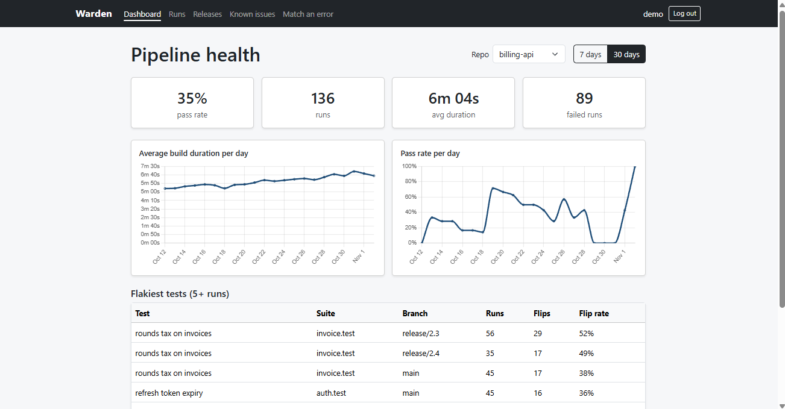

# Warden

## Authors

Kaleb Maloof and Vincent Putiri

## Class Link

<!-- TODO: replace # with the class link -->

[CS5610 Web Development, Northeastern University](#)

## Project Objective

Warden shows teams how healthy their CI pipelines are. Log CI runs with their test results, then see pass rate, build time trends, and which tests are flaky over the past week or month. Teams that maintain several releases for different clients can track each release on its own and see exactly when tests started failing. A known issues board records recurring failures, which releases they affect, and investigation notes, and you can paste an error from a failed build to check whether it's already documented.

## Design Document

[Warden design document (Excalidraw)](https://app.excalidraw.com/s/78Atiz9VS0P/9SRIrRapM4T)

## Data Sources

The seed data is synthetic and generated by `npm run seed`. Generation is deterministic, with dates relative to the day you run it, so the dashboard always has recent data.

| Collection   | Records | What's in it                                                                                                                                                                                                       |
| ------------ | ------- | ------------------------------------------------------------------------------------------------------------------------------------------------------------------------------------------------------------------ |
| runs         | 1,200   | CI runs across 3 repositories and 7 releases over the past 60 days, each with 15 to 30 test results. A few tests are deliberately flaky, and one release has a regression that starts 6 days before the seed date. |
| knownIssues  | 40      | Known CI problems across all categories and statuses, with error snippets that match failures in the seeded runs.                                                                                                  |
| issueUpdates | 100     | Timestamped investigation notes on the known issues.                                                                                                                                                               |
| users        | 1       | The demo account, set by `DEMO_USERNAME` and `DEMO_PASSWORD`.                                                                                                                                                      |

## Screenshot

## Instructions to Build

Requirements: Node.js 22+ and Docker Desktop.

Install dependencies:

    npm install

Copy `.env.example` to `.env`, then set `SESSION_SECRET` to a long random string and `DEMO_PASSWORD` to the password for the seeded demo account.

Start MongoDB and load the seed data:

    npm run db:up
    npm run seed

Start the dev server:

    npm run dev

Open http://localhost:5173 and log in with the demo account (username `demo` unless you changed `DEMO_USERNAME`), or sign up for a new account. New accounts start empty, because each user's data is private.

To run the production build instead:

    npm run build
    npm start

Then open http://localhost:3000.

## How to Use

- **Runs:** log a CI run by filling in the form or pasting a JSON summary, then filter run history by repository, release, branch, status, or date, and open a run to see which tests failed.
- **Dashboard:** pick a repository and a 7-day or 30-day range to see pass rate, build duration trends, and the flakiest tests.
- **Releases:** pick a repository to compare its releases side by side, then open one to see each test's pass and fail history across runs.
- **Known issues:** record recurring CI problems, filter them, and add investigation updates as you work on them.
- **Match an error:** paste an error message from a failed build to find known issues that match it.

## License

MIT, see [LICENSE](LICENSE).
